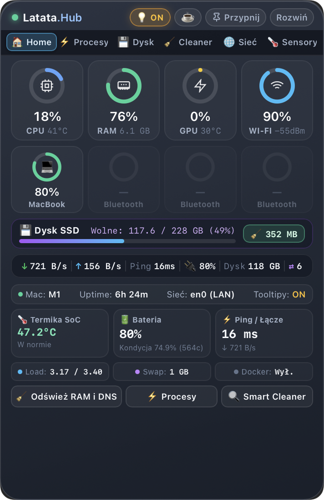

# Latata.Hub ⚡

> **A native, ultra-lightweight macOS desktop system monitor & control widget.**  
> Built with [TinyJS](https://tinyjs.app) (txiki.js QuickJS engine + native WebKit WKWebView) and an Objective-C hardware helper. Zero Electron bloat.

---

**English** • [🇵🇱 Polska wersja językowa (README.pl.md)](README.pl.md)

---

<p align="center">
  
</p>

---

## ⚡ Performance Highlights

- **RAM Footprint**: **~35 MB** total memory consumption (vs 250–400 MB in typical Electron-based apps).
- **Idle CPU Usage**: **< 0.5%** on Apple Silicon M-series chips.
- **Hardware Telemetry Latency**: **~140 ms** sampling pass with zero background disk thrashing.
- **Executable Bundle Size**: **~4 MB** compressed standalone `.app`.

---

## ✨ Features

- **Apple-Style Status Rings**: Real-time circular gauges for CPU, RAM, GPU, and Wi-Fi signal.
- **Battery & Peripheral Telemetry**: Live status for internal MacBook battery and connected Bluetooth accessories (AirPods, Magic Mouse, Trackpad, Keyboards).
- **Disk Capacity & Storage Explorer**: Fast disk space analyzer with safe scanning for largest directories and files.
- **Smart Cleaner**: Safely clean user app caches, system logs, DNS cache (`dscacheutil`), and Trash (with native confirmation).
- **Top 10 Processes**: Ranked live CPU and RAM consumption with extracted native macOS application icons and 1-Click Process Kill (with PID recycling protection).
- **Developer Localhost Port Inspector**: Real-time listing of listening TCP ports, bound services, Docker daemon status, and process termination.
- **Interactive Tooltip Engine**: Informative floating dark-glass tooltips with a quick titlebar `[ 💡 ON / OFF ]` toggle.
- **Window Management**:
  - **Always on Top (`Przypnij`)**: Pin the widget above all windows or keep it in the normal desktop layer.
  - **Compact / Expand (`Zwiń / Rozwiń`)**: Toggle between compact (356×548) and full expanded (356×760) view.
  - **Caffeinate Mode (`☕`)**: Prevent system sleep with PID-bound auto-termination (`caffeinate -w <PID>`).
- **Privacy-First Architecture (TCC Compliant)**: Safely inspects system metrics without probing personal directories (`Desktop`, `Documents`, `Photos`).

---

## 🏗 Architecture

```
                    ┌────────────────────────┐
                    │      WebKit UI         │
                    │   (HTML5, CSS, JS)     │
                    └───────────┬────────────┘
                                │ JSON RPC (WebKit messageHandlers)
                    ┌───────────▼────────────┐
                    │     txiki.js Engine    │
                    │  (QuickJS + libuv)     │
                    └───────────┬────────────┘
                                │ JSON stream over stdout (libuv spawn)
                    ┌───────────▼────────────┐
                    │  Native Helper (Obj-C) │
                    │ (libproc, IOKit, WLAN) │
                    └────────────────────────┘
```

1. **Frontend**: Pure HTML5, modern CSS3 (macOS vibrancy glass, custom scrollbars, SVG gauge animations), and vanilla JavaScript.
2. **Backend**: `src/backend/main.js` running on `txiki.js`, handling IPC dispatch, telemetry aggregation, smart alerts, and system tray.
3. **Native Sidecar (`macmon`)**: Objective-C binary compiled with Cocoa, IOKit, and CoreWLAN for direct kernel and hardware telemetry.

---

## 🚀 Getting Started

### Prerequisites

- macOS 12 Monterey or newer on Apple Silicon (M1/M2/M3/M4).
- [TinyJS CLI](https://tinyjs.app) (version >= 0.70.3):
  ```bash
  curl -fsSL https://tinyjs.app/install | bash
  ```
- Command Line Tools for compilation (`xcode-select --install`).

### Development

To start the live development widget:
```bash
git clone https://github.com/wojtaczu/Latata-Hub.git
cd Latata-Hub
tinyjs dev
```

### Running Tests

Latata.Hub includes an automated End-to-End test suite covering native contracts, backend IPC, and frontend WebKit interactions:

```bash
# Run backend & native telemetry tests in Terminal
./test/run-e2e.sh

# Run live UI test runner inside a WebKit window
./test/run-e2e.sh --ui
```

### Building Application Bundle

To build a standalone `.app` bundle:
```bash
tinyjs build
```
The compiled application will be generated in `dist/Latata.Hub.app`.

### Compiling Native Helper

If you modify `src/native/macmon.m`, recompile the binary helper with:
```bash
npm run build:native
```

---

## 🛡 Privacy & Security

Latata.Hub is designed with strict respect for macOS Transparency, Consent, and Control (TCC):
- **Zero Tracking**: No telemetry, analytics, or third-party trackers.
- **Network Traffic**: The only outbound requests are optional ping/DNS latency tests to Cloudflare `1.1.1.1` and user-initiated speed tests.
- **Safe Icon Extraction**: Icons are strictly resolved from `/Applications/` and `/System/`. User home directories are never inspected by `NSWorkspace`.
- **Safe Cleaning**: The Smart Cleaner strictly targets user caches (`~/Library/Caches`), user logs, and Trash. System files (`com.apple.*`) and temporary files of other active apps are untouched. Operates entirely without root (`sudo`) privileges.

---

## 💡 Troubleshooting (macOS Gatekeeper)

Because Latata.Hub is an open-source hobby project distributed without an Apple Developer subscription certificate, macOS Gatekeeper may display a prompt on first launch.

To open the app:
- **Option 1**: Right-click `Latata.Hub.app` in Finder and select **Open**, then click **Open** in the dialog.
- **Option 2**: In Terminal, remove the quarantine attribute:
  ```bash
  xattr -cr /Applications/Latata.Hub.app
  ```

---

## 📄 License

This project is licensed under the MIT License — see the [LICENSE](LICENSE) file for details.
