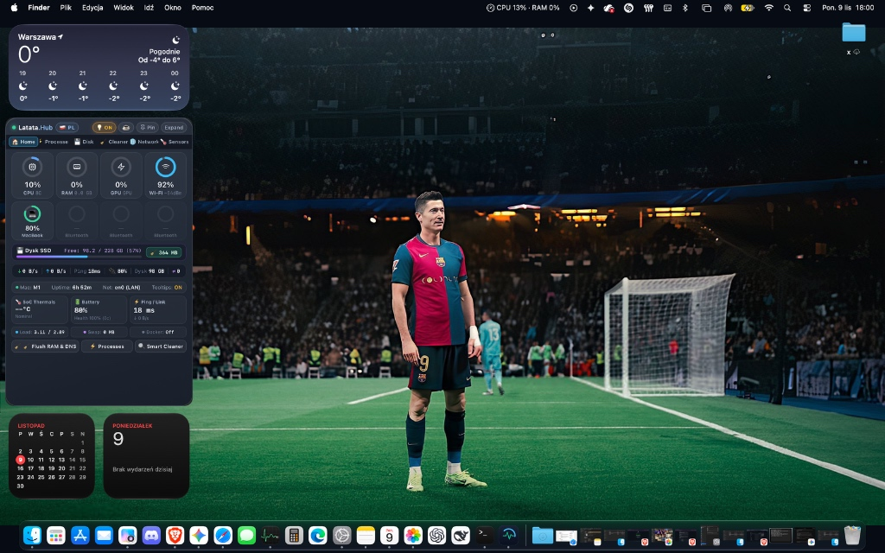
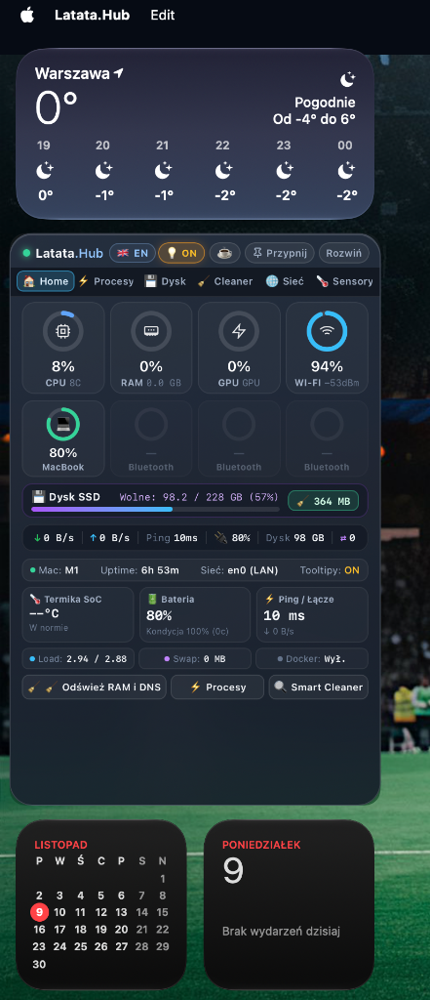
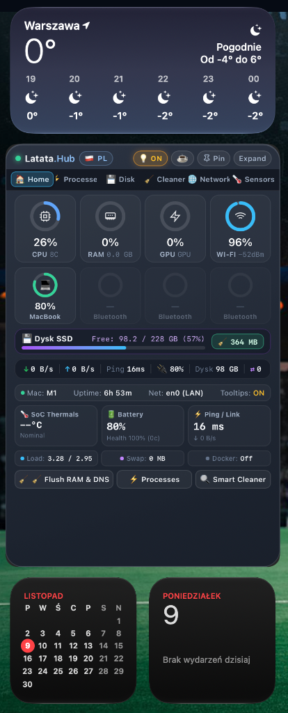

# Latata.Hub ⚡

> **Natywny, ultralekki widget monitorowania systemu i kontroli procesów dla macOS.**  
> Zbudowany na silniku [TinyJS](https://tinyjs.app) (txiki.js QuickJS + natywny WebKit WKWebView) z modułem pomocniczym w Objective-C. Całkowity brak narzutu pamięciowego Electrona.

---

[English Version (README.md)](README.md) • **Polski**

---

<p align="center">
  
</p>

<p align="center">
  <em>Latata.Hub działający natywnie na pulpicie macOS obok widgetów systemowych.</em>
</p>

<p align="center">
  
  &nbsp;
  
</p>

<p align="center">
  <em>Pełna dwujęzyczność: wersja polska (z lewej) i angielska (z prawej) przełączana 1 kliknięciem w nagłówku.</em>
</p>

---

## 📦 Pobieranie i Szybka Instalacja

Gotowa, skompilowana aplikacja dla **Apple Silicon (macOS 12 Monterey lub nowszy, M1/M2/M3/M4)** jest dostępna w sekcji GitHub Releases:

[-0284c7?style=for-the-badge&logo=apple&logoColor=white)](https://github.com/wojtaczu/Latata-Hub/releases/latest/download/Latata.Hub-macos-arm64.zip)

1. Pobierz plik [`Latata.Hub-macos-arm64.zip`](https://github.com/wojtaczu/Latata-Hub/releases/latest/download/Latata.Hub-macos-arm64.zip).
2. Rozpakuj i przeciągnij `Latata.Hub.app` do folderu `/Applications` (Programy).
3. *(Tylko przy pierwszym uruchomieniu)* Ponieważ jest to niepodpisana komercyjnie aplikacja open-source, jeśli macOS Gatekeeper wyświetli ostrzeżenie, usuń flagę kwarantanny poleceniem w Terminalu:
   ```bash
   xattr -cr /Applications/Latata.Hub.app
   ```

---

## ⚡ Kluczowe Osiągi

- **Zużycie RAM**: **~35 MB** całkowitego narzutu pamięci (w porównaniu do 250–400 MB w typowych monitorach opartych na Electronie).
- **Obciążenie CPU w spoczynku**: **< 0.5%** na układach Apple Silicon z serii M.
- **Czas próbkowania telemetrii**: **~140 ms** (brak ciągłego mielenia dyskiem SSD w tle).
- **Rozmiar gotowej aplikacji**: **~4 MB** skompresowana, samodzielna aplikacja `.app`.

---

## ✨ Główne Możliwości

- **Pierścienie telemetryczne Apple**: Płynne, animowane pierścienie wskaźników obciążenia w czasie rzeczywistym dla procesora (CPU), pamięci RAM, grafiki (GPU) oraz siły sygnału Wi-Fi.
- **Baterie i akcesoria Bluetooth**: Odczyt na żywo poziomu naładowania baterii wewnętrznej MacBooka oraz podłączonych peryferiów Bluetooth (AirPods, Magic Mouse, Magic Trackpad, klawiatury bezprzewodowe).
- **Pojemność Dysku i Eksplorator pamięci masowej**: Szybki podgląd zajętości dysku SSD wraz z bezpiecznym skanerem największych folderów i plików w katalogu domowym i aplikacjach.
- **Smart Cleaner (Czyszczenie Systemu)**: Bezpieczne czyszczenie pamięci podręcznej aplikacji (cache), logów użytkownika, pamięci podręcznej DNS (`dscacheutil`) oraz Kosza (z natywnym potwierdzeniem).
- **Top 10 Procesów**: Lista procesów najbardziej obciążających CPU i RAM, zintegrowana z natywnymi ikonami aplikacji macOS oraz natychmiastowym przyciskiem zakończenia procesu (1-Click Kill z ochroną przed PID recycling).
- **Inspektor portów Localhost dla deweloperów**: Podgląd na żywo nasłuchujących portów TCP, procesów deweloperskich, stanu silnika Docker oraz możliwość zwalniania zablokowanych portów.
- **Interaktywny silnik podpowiedzi (Tooltipy)**: Pływające dymki informacyjne z ciemnego szkła z wygodnym przełącznikiem `[ 💡 ON / OFF ]` na pasku tytułowym.
- **Pełna dwujęzyczność**: Błyskawiczny przełącznik języka (`[ 🇬🇧 EN ]` / `[ 🇵🇱 PL ]`) z trwałym zapamiętywaniem preferencji użytkownika.
- **Zarządzanie oknem widgetu**:
  - **Zawsze na wierzchu (`Przypnij` / `Przypięto`)**: Przypnij widget nad wszystkimi oknami lub trzymaj go na standardowej warstwie biurka.
  - **Dopasowany / Pełny (`Rozwiń` / `Zwiń`)**: Przełączaj między kompaktowym widokiem (356×548) a pełną kolumną (356×760).
  - **Tryb Caffeinate (`☕`)**: Zablokuj usypianie Maca z automatycznym wygaszaniem procesu po zamknięciu aplikacji (`caffeinate -w <PID>`).
- **Prywatność i bezpieczeństwo (TCC Compliant)**: Pełna ochrona prywatności – aplikacja nie przeszukuje prywatnych folderów użytkownika (`Biurko`, `Dokumenty`, `Zdjęcia`).

---

## 🏗 Architektura Projektu

```
                    ┌────────────────────────┐
                    │      Interfejs UI      │
                    │   (HTML5, CSS, JS)     │
                    └───────────┬────────────┘
                                │ JSON RPC (WebKit messageHandlers)
                    ┌───────────▼────────────┐
                    │     Silnik txiki.js    │
                    │  (QuickJS + libuv)     │
                    └───────────┬────────────┘
                                │ Strumień JSON przez stdout (libuv spawn)
                    ┌───────────▼────────────┐
                    │  Moduł pomocniczy Obj-C│
                    │ (libproc, IOKit, WLAN) │
                    └────────────────────────┘
```

1. **Frontend**: Czysty HTML5, nowoczesny CSS3 (efekt szklanego rozmycia macOS vibrancy hud, płynne animacje SVG) oraz JavaScript bez ciężkich frameworków.
2. **Backend**: `src/backend/main.js` działający na `txiki.js`, zarządzający agregacją danych telemetrycznych, alertami i menu w pasku menu macOS (Tray).
3. **Moduł natywny (`macmon`)**: Plik wykonywalny w Objective-C skompilowany z Cocoa, IOKit i CoreWLAN, pobierający parametry bezpośrednio z jądra macOS.

---

## 🚀 Uruchomienie i Rozwój

### Wymagania wstępne

- macOS 12 Monterey lub nowszy na procesorach Apple Silicon (M1/M2/M3/M4).
- Zainstalowane narzędzie [TinyJS CLI](https://tinyjs.app) (wersja >= 0.70.3):
  ```bash
  curl -fsSL https://tinyjs.app/install | bash
  ```
- Narzędzia wiersza poleceń macOS (`xcode-select --install`).

### Uruchomienie w trybie deweloperskim

```bash
git clone https://github.com/wojtaczu/Latata-Hub.git
cd Latata-Hub
tinyjs dev
```

### Uruchamianie testów E2E

Latata.Hub posiada pełen pakiet automatycznych testów weryfikujących poprawność backendu i interfejsu WebKit:

```bash
# Testy warstwy backendowej i natywnej w terminalu
./test/run-e2e.sh

# Testy interfejsu UI na żywo w oknie WebKit (animacje i symulacje kliknięć)
./test/run-e2e.sh --ui
```

### Budowanie gotowej aplikacji (`.app`)

Aby utworzyć gotowy plik aplikacji dla macOS:
```bash
tinyjs build
```
Skompilowana aplikacja zostanie wygenerowana w katalogu `dist/Latata.Hub.app`.

### Kompilacja modułu pomocniczego `macmon`

W przypadku edycji pliku `src/native/macmon.m`, rekompilację wykonasz poleceniem:
```bash
npm run build:native
```

---

## 🛡 Prywatność i Bezpieczeństwo

Latata.Hub respektuje mechanizmy bezpieczeństwa macOS TCC:
- **Zero telemetrii i śledzenia**: Brak analityki, modułów śledzących i zewnętrznych połączeń reklamowych.
- **Ruch sieciowy**: Jedyne połączenia wychodzące to bezpieczne odpytanie DNS/ping do Cloudflare `1.1.1.1` oraz test prędkości uruchamiany wyłącznie na żądanie użytkownika.
- **Bezpieczne pobieranie ikon**: Ikony aplikacji pobierane są wyłącznie ze znormalizowanych ścieżek `/Applications/` i `/System/`.
- **Bezpieczny Smart Cleaner**: Czyści wyłącznie bezpieczne katalogi tymczasowe w folderze użytkownika (`~/Library/Caches`, logi użytkownika, Kosz). Pliki systemowe (`com.apple.*`) i pliki innych aktywnych apek są nienaruszane. Działa bez uprawnień roota (`sudo`).

---

## 💡 Rozwiązywanie problemów (macOS Gatekeeper)

Ponieważ Latata.Hub to projekt open-source udostępniany bez płatnego certyfikatu Apple Developer, macOS Gatekeeper może wyświetlić ostrzeżenie o nieznanym deweloperze przy pierwszym uruchomieniu pobranej aplikacji.

Aby uruchomić aplikację:
- **Sposób 1**: Kliknij na `Latata.Hub.app` prawym przyciskiem myszy w Finderze i wybierz **Otwórz**, a następnie kliknij **Otwórz** w oknie dialogowym.
- **Sposób 2**: W Terminalu usuń atrybut kwarantanny:
  ```bash
  xattr -cr /Applications/Latata.Hub.app
  ```

---

## 📄 Licencja

Projekt jest udostępniany na zasadach licencji MIT — szczegóły w pliku [LICENSE](LICENSE).
